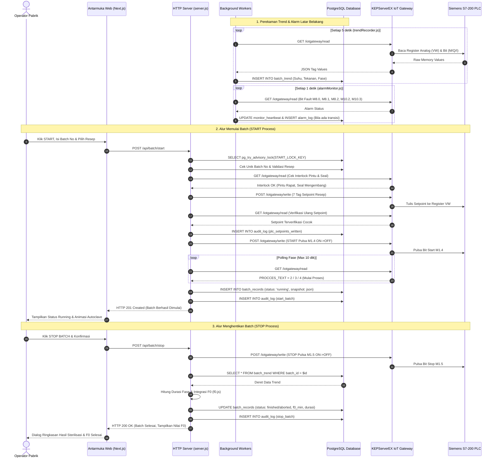

# Peta Relasi & Hubungan Antar File (Dependency Map)

Dokumen ini memetakan seluruh hubungan impor internal dan ketergantungan antar berkas pada proyek `scada-sterilizer` yang diverifikasi secara aktual melalui analisis statis kode sumber.

---

## 1. Diagram Relasi Route → Komponen → Lib / API

Diagram Mermaid berikut memetakan hubungan hierarki dari rute antarmuka pengguna ke komponen pembangun dan modul pustaka / endpoint API yang digunakan:

```mermaid
flowchart TD
    subgraph Routes["Rute Halaman & Layar Antarmuka"]
        R_Root["src/app/layout.js"]
        R_Login["src/app/login/page.js"]
        R_App["src/app/(app)/layout.js"]
        R_Dash["src/app/(app)/page.js"]
        R_Alarm["src/app/(app)/alarm/page.js"]
        R_Audit["src/app/(app)/audit-log/page.js"]
        R_Report["src/app/(app)/data-report/page.js"]
        R_ReportDetail["src/app/(app)/data-report/[batchNo]/page.js"]
        R_Formula["src/app/(app)/formula/page.js"]
        R_Products["src/app/(app)/products/page.js"]
        R_Trend["src/app/(app)/trend/page.js"]
        R_Users["src/app/(app)/users/page.js"]
    end

    subgraph Components["Komponen Antarmuka Pengguna (src/components)"]
        C_Navbar["Navbar.js"]
        C_AlarmCenter["AlarmCenter.js"]
        C_ScreenLock["ScreenLock.js"]
        C_AtvDiagram["AtvDiagram.js"]
        C_StartDialog["StartDialog.js"]
    end

    subgraph API["Backend API Handlers (src/app/api)"]
        API_Status["status/route.js"]
        API_AuthLogin["auth/login/route.js"]
        API_AuthLogout["auth/logout/route.js"]
        API_AuthMe["auth/me/route.js"]
        API_AuthUnlock["auth/unlock/route.js"]
        API_BatchStart["batch/start/route.js"]
        API_BatchStop["batch/stop/route.js"]
        API_BatchRecords["batch-records/route.js"]
        API_BatchDetail["batch-records/[batchNo]/route.js"]
        API_AlarmsActive["alarms/active/route.js"]
        API_Formulas["formulas/route.js"]
        API_PlcReset["plc/reset/route.js"]
    end

    subgraph Libs["Pustaka Logika Bisnis & Integrasi (src/lib)"]
        L_Db["db.js (PostgreSQL)"]
        L_Plc["plc.js (KEPServerEX)"]
        L_PlcWrite["plcWrite.js"]
        L_Auth["auth.js (JWT jose)"]
        L_Audit["auditLog.js"]
        L_Finalize["batchFinalize.js"]
        L_F0["f0.js"]
        L_RecipeVal["recipeValidation.js"]
        L_RecipeGuard["recipeGuard.js"]
        L_AlarmMon["alarmMonitor.js"]
        L_TrendRec["trendRecorder.js"]
    end

    %% Relasi Rute ke Layout & Komponen
    R_Root --> R_App
    R_App --> C_Navbar
    R_App --> C_AlarmCenter
    R_App --> C_ScreenLock
    R_Dash --> C_AtvDiagram
    R_Dash --> C_StartDialog

    %% Komponen / Halaman memanggil API
    R_Login -.-> API_AuthLogin
    C_Navbar -.-> API_AuthLogout
    R_App -.-> API_AuthMe
    C_ScreenLock -.-> API_AuthUnlock
    C_AlarmCenter -.-> API_AlarmsActive
    R_Dash -.-> API_Status
    C_StartDialog -.-> API_BatchStart
    R_Dash -.-> API_BatchStop
    R_Dash -.-> API_PlcReset
    R_Report -.-> API_BatchRecords
    R_ReportDetail -.-> API_BatchDetail
    R_Trend -.-> API_BatchDetail
    R_Formula -.-> API_Formulas

    %% API ke Pustaka Libs
    API_Status --> L_Plc
    API_Status --> L_Db
    API_AuthLogin --> L_Auth
    API_AuthLogin --> L_Audit
    API_AuthLogin --> L_Db
    API_BatchStart --> L_Plc
    API_BatchStart --> L_PlcWrite
    API_BatchStart --> L_RecipeVal
    API_BatchStart --> L_RecipeGuard
    API_BatchStart --> L_Audit
    API_BatchStart --> L_Db
    API_BatchStop --> L_PlcWrite
    API_BatchStop --> L_Finalize
    API_BatchStop --> L_Audit
    API_Finalize --> L_F0
    API_Finalize --> L_Db
```

---

## 2. Diagram Alur Data Utama (Main Data Flow)

Diagram berikut memetakan alur pertukaran data antara operator web, antarmuka browser, server Next.js, database PostgreSQL, dan mesin PLC fisik Siemens S7-200 via KEPServerEX:

---

## 3. Tabel Hubungan Impor Antar File

Tabel berikut memuat daftar seluruh berkas kode sumber beserta file yang di-import langsung (import / require) dan file yang meng-import-nya (imported by), diverifikasi secara aktual tanpa estimasi:

| Berkas | Meng-import (Internal) | Dipakai Oleh (Imported By) |
| :--- | :--- | :--- |
| `.env.local` | — | — |
| `.gitignore` | — | — |
| `README.md` | — | — |
| `context/ROADMAP (12).md` | — | — |
| `context/SiemensS7-200.csv` | — | — |
| `context/export_atv.awl` | — | — |
| `eslint.config.mjs` | — | — |
| `jsconfig.json` | — | — |
| `next.config.mjs` | — | — |
| `package-lock.json` | — | — |
| `package.json` | — | — |
| `postcss.config.mjs` | — | — |
| `public/satoria-logo.png` | — | — |
| `public/sounds/alarm.wav` | — | — |
| `scripts/hash-password.js` | — | — |
| `server.js` | `src/lib/trendRecorder.js` `src/lib/alarmMonitor.js` | — |
| `src/app/(app)/alarm/page.js` | `src/lib/alarmEventLabels.js` | — |
| `src/app/(app)/audit-log/page.js` | — | — |
| `src/app/(app)/data-report/[batchNo]/page.js` | — | — |
| `src/app/(app)/data-report/page.js` | — | — |
| `src/app/(app)/formula/page.js` | — | — |
| `src/app/(app)/layout.js` | `src/app/globals.css` `src/components/Navbar.js` `src/components/AlarmCenter.js` `src/components/ScreenLock.js` | — |
| `src/app/(app)/page.js` | `src/lib/plcCommandAlert.js` `src/components/AtvDiagram.js` `src/lib/atvProcess.js` `src/components/StartDialog.js` | — |
| `src/app/(app)/products/page.js` | — | — |
| `src/app/(app)/trend/page.js` | — | — |
| `src/app/(app)/users/page.js` | — | — |
| `src/app/api/alarms/active/route.js` | `src/lib/db.js` `src/lib/alarmCatalog.js` | — |
| `src/app/api/alarms/by-batch/[batchNo]/route.js` | `src/lib/db.js` | — |
| `src/app/api/alarms/event-types/route.js` | `src/lib/db.js` | — |
| `src/app/api/alarms/print-data/route.js` | `src/lib/db.js` `src/lib/alarmQuery.js` | — |
| `src/app/api/alarms/route.js` | `src/lib/db.js` `src/lib/alarmQuery.js` | — |
| `src/app/api/audit-log/export/route.js` | `src/lib/db.js` `src/lib/auth.js` `src/lib/dateRange.js` | — |
| `src/app/api/audit-log/filters/route.js` | `src/lib/db.js` `src/lib/auth.js` | — |
| `src/app/api/audit-log/route.js` | `src/lib/db.js` `src/lib/auth.js` `src/lib/dateRange.js` | — |
| `src/app/api/auth/login/route.js` | `src/lib/db.js` `src/lib/auth.js` `src/lib/auditLog.js` | — |
| `src/app/api/auth/logout/route.js` | `src/lib/auth.js` `src/lib/auditLog.js` | — |
| `src/app/api/auth/me/route.js` | `src/lib/auth.js` `src/lib/db.js` | — |
| `src/app/api/auth/unlock/route.js` | `src/lib/db.js` `src/lib/auth.js` `src/lib/auditLog.js` | — |
| `src/app/api/auth/users/route.js` | `src/lib/db.js` | — |
| `src/app/api/batch-records/[batchNo]/route.js` | `src/lib/db.js` `src/lib/recipeSnapshot.js` | — |
| `src/app/api/batch-records/export/route.js` | `src/lib/db.js` `src/lib/auth.js` `src/lib/dateRange.js` | — |
| `src/app/api/batch-records/route.js` | `src/lib/db.js` `src/lib/dateRange.js` | — |
| `src/app/api/batch/start/route.js` | `src/lib/db.js` `src/lib/auth.js` `src/lib/plc.js` `src/lib/plcWrite.js` `src/lib/recipeValidation.js` `src/lib/batchNo.js` `src/lib/recipeSnapshot.js` `src/lib/recipeGuard.js` | — |
| `src/app/api/batch/stop/route.js` | `src/lib/db.js` `src/lib/auth.js` `src/lib/plc.js` `src/lib/plcWrite.js` `src/lib/batchFinalize.js` `src/lib/auditLog.js` | — |
| `src/app/api/formulas/[formulaNo]/route.js` | `src/lib/db.js` `src/lib/auth.js` `src/lib/recipeValidation.js` `src/lib/recipeGuard.js` | — |
| `src/app/api/formulas/route.js` | `src/lib/db.js` `src/lib/auth.js` `src/lib/recipeValidation.js` | — |
| `src/app/api/plc/reset/route.js` | `src/lib/db.js` `src/lib/auth.js` `src/lib/plc.js` `src/lib/plcWrite.js` `src/lib/auditLog.js` | — |
| `src/app/api/product-specs/[id]/route.js` | `src/lib/db.js` `src/lib/auth.js` | — |
| `src/app/api/product-specs/route.js` | `src/lib/db.js` `src/lib/auth.js` | — |
| `src/app/api/products/[id]/route.js` | `src/lib/db.js` `src/lib/auth.js` | — |
| `src/app/api/products/route.js` | `src/lib/db.js` `src/lib/auth.js` | — |
| `src/app/api/status/route.js` | `src/lib/plc.js` `src/lib/db.js` | — |
| `src/app/api/users/[username]/reset-password/route.js` | `src/lib/db.js` `src/lib/auth.js` | — |
| `src/app/api/users/[username]/route.js` | `src/lib/db.js` `src/lib/auth.js` | — |
| `src/app/api/users/route.js` | `src/lib/db.js` `src/lib/auth.js` | — |
| `src/app/globals.css` | — | `src/app/(app)/layout.js` `src/app/layout.js` |
| `src/app/layout.js` | `src/app/globals.css` | — |
| `src/app/login/page.js` | — | — |
| `src/app/print/alarm/page.js` | `src/lib/alarmEventLabels.js` | — |
| `src/app/print/audit-log/page.js` | — | — |
| `src/app/print/batch-records/page.js` | — | — |
| `src/app/print/data-report/[batchNo]/curve/page.js` | — | — |
| `src/app/print/data-report/[batchNo]/page.js` | `src/lib/alarmEventLabels.js` | — |
| `src/components/AlarmCenter.js` | `src/lib/alarmView.js` | `src/app/(app)/layout.js` |
| `src/components/AtvDiagram.js` | `src/lib/atvProcess.js` | `src/app/(app)/page.js` |
| `src/components/Navbar.js` | — | `src/app/(app)/layout.js` |
| `src/components/ScreenLock.js` | — | `src/app/(app)/layout.js` |
| `src/components/StartDialog.js` | `src/lib/batchNo.js` `src/lib/plcCommandAlert.js` | `src/app/(app)/page.js` |
| `src/lib/__fixtures__/printout_2026-10-03.js` | — | `src/lib/f0.test.mjs` |
| `src/lib/alarmCatalog.js` | — | `src/app/api/alarms/active/route.js` `src/lib/alarmMonitor.js` |
| `src/lib/alarmEpisodes.js` | — | `src/lib/alarmEpisodes.test.mjs` `src/lib/alarmMonitor.js` |
| `src/lib/alarmEpisodes.test.mjs` | `src/lib/alarmEpisodes.js` | — |
| `src/lib/alarmEventLabels.js` | — | `src/app/(app)/alarm/page.js` `src/app/print/alarm/page.js` `src/app/print/data-report/[batchNo]/page.js` |
| `src/lib/alarmMonitor.js` | `src/lib/db.js` `src/lib/plc.js` `src/lib/alarmCatalog.js` `src/lib/alarmEpisodes.js` `src/lib/recipeGuard.js` `src/lib/recipeSnapshot.js` | `server.js` |
| `src/lib/alarmQuery.js` | `src/lib/dateRange.js` | `src/app/api/alarms/print-data/route.js` `src/app/api/alarms/route.js` |
| `src/lib/alarmView.js` | — | `src/components/AlarmCenter.js` `src/lib/alarmView.test.mjs` |
| `src/lib/alarmView.test.mjs` | `src/lib/alarmView.js` | — |
| `src/lib/atvProcess.js` | — | `src/app/(app)/page.js` `src/components/AtvDiagram.js` |
| `src/lib/auditLog.js` | `src/lib/db.js` | `src/app/api/auth/login/route.js` `src/app/api/auth/logout/route.js` `src/app/api/auth/unlock/route.js` `src/app/api/batch/stop/route.js` `src/app/api/plc/reset/route.js` |
| `src/lib/auth.js` | `src/lib/db.js` | `src/app/api/audit-log/export/route.js` `src/app/api/audit-log/filters/route.js` `src/app/api/audit-log/route.js` `src/app/api/auth/login/route.js` `src/app/api/auth/logout/route.js` `src/app/api/auth/me/route.js` `src/app/api/auth/unlock/route.js` `src/app/api/batch/start/route.js` `src/app/api/batch/stop/route.js` `src/app/api/batch-records/export/route.js` `src/app/api/formulas/route.js` `src/app/api/formulas/[formulaNo]/route.js` `src/app/api/plc/reset/route.js` `src/app/api/product-specs/route.js` `src/app/api/product-specs/[id]/route.js` `src/app/api/products/route.js` `src/app/api/products/[id]/route.js` `src/app/api/users/route.js` `src/app/api/users/[username]/reset-password/route.js` `src/app/api/users/[username]/route.js` |
| `src/lib/batchFinalize.js` | `src/lib/batchFinalize.js` `src/lib/db.js` `src/lib/f0.js` | `src/app/api/batch/stop/route.js` `src/lib/batchFinalize.js` `src/lib/trendRecorder.js` |
| `src/lib/batchNo.js` | — | `src/app/api/batch/start/route.js` `src/components/StartDialog.js` |
| `src/lib/dateRange.js` | — | `src/app/api/audit-log/export/route.js` `src/app/api/audit-log/route.js` `src/app/api/batch-records/export/route.js` `src/app/api/batch-records/route.js` `src/lib/alarmQuery.js` |
| `src/lib/db.js` | — | `src/app/api/alarms/active/route.js` `src/app/api/alarms/by-batch/[batchNo]/route.js` `src/app/api/alarms/event-types/route.js` `src/app/api/alarms/print-data/route.js` `src/app/api/alarms/route.js` `src/app/api/audit-log/export/route.js` `src/app/api/audit-log/filters/route.js` `src/app/api/audit-log/route.js` `src/app/api/auth/login/route.js` `src/app/api/auth/me/route.js` `src/app/api/auth/unlock/route.js` `src/app/api/auth/users/route.js` `src/app/api/batch/start/route.js` `src/app/api/batch/stop/route.js` `src/app/api/batch-records/export/route.js` `src/app/api/batch-records/route.js` `src/app/api/batch-records/[batchNo]/route.js` `src/app/api/formulas/route.js` `src/app/api/formulas/[formulaNo]/route.js` `src/app/api/plc/reset/route.js` `src/app/api/product-specs/route.js` `src/app/api/product-specs/[id]/route.js` `src/app/api/products/route.js` `src/app/api/products/[id]/route.js` `src/app/api/status/route.js` `src/app/api/users/route.js` `src/app/api/users/[username]/reset-password/route.js` `src/app/api/users/[username]/route.js` `src/lib/alarmMonitor.js` `src/lib/auditLog.js` `src/lib/auth.js` `src/lib/batchFinalize.js` `src/lib/trendRecorder.js` |
| `src/lib/f0.js` | — | `src/lib/batchFinalize.js` `src/lib/f0.test.mjs` |
| `src/lib/f0.test.mjs` | `src/lib/f0.js` `src/lib/__fixtures__/printout_2026-10-03.js` | — |
| `src/lib/plc.js` | — | `src/app/api/batch/start/route.js` `src/app/api/batch/stop/route.js` `src/app/api/plc/reset/route.js` `src/app/api/status/route.js` `src/lib/alarmMonitor.js` `src/lib/trendRecorder.js` |
| `src/lib/plcCommandAlert.js` | — | `src/app/(app)/page.js` `src/components/StartDialog.js` `src/lib/plcCommandAlert.test.mjs` |
| `src/lib/plcCommandAlert.test.mjs` | `src/lib/plcCommandAlert.js` | — |
| `src/lib/plcWrite.js` | — | `src/app/api/batch/start/route.js` `src/app/api/batch/stop/route.js` `src/app/api/plc/reset/route.js` |
| `src/lib/recipeGuard.js` | — | `src/app/api/batch/start/route.js` `src/app/api/formulas/[formulaNo]/route.js` `src/lib/alarmMonitor.js` |
| `src/lib/recipeSnapshot.js` | — | `src/app/api/batch/start/route.js` `src/app/api/batch-records/[batchNo]/route.js` `src/lib/alarmMonitor.js` |
| `src/lib/recipeValidation.js` | — | `src/app/api/batch/start/route.js` `src/app/api/formulas/route.js` `src/app/api/formulas/[formulaNo]/route.js` |
| `src/lib/trendRecorder.js` | `src/lib/db.js` `src/lib/plc.js` `src/lib/batchFinalize.js` | `server.js` |
| `src/proxy.js` | — | — |